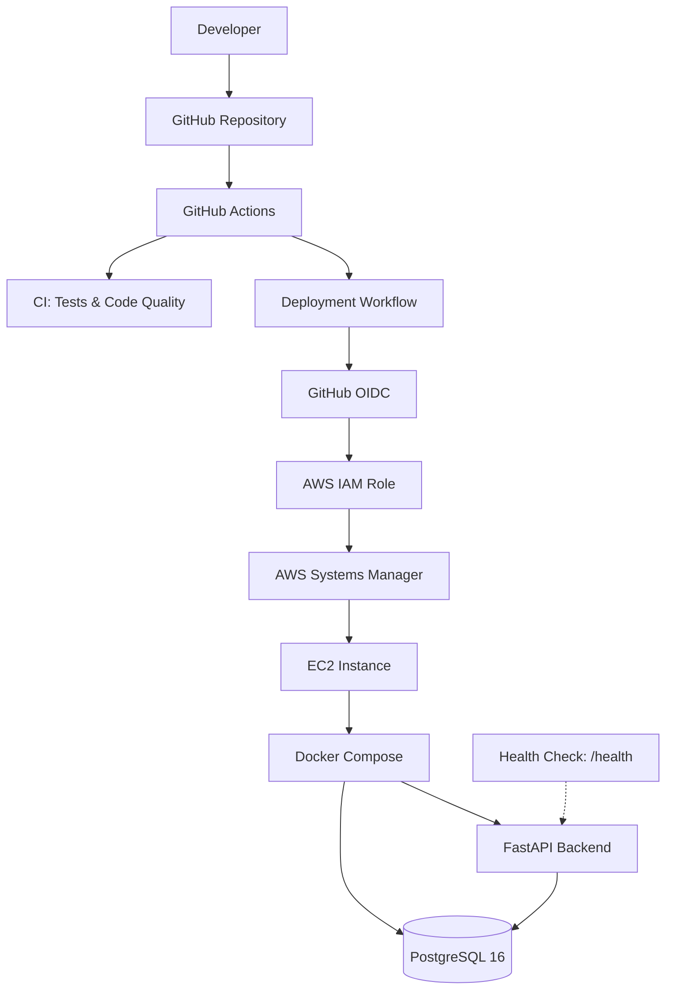
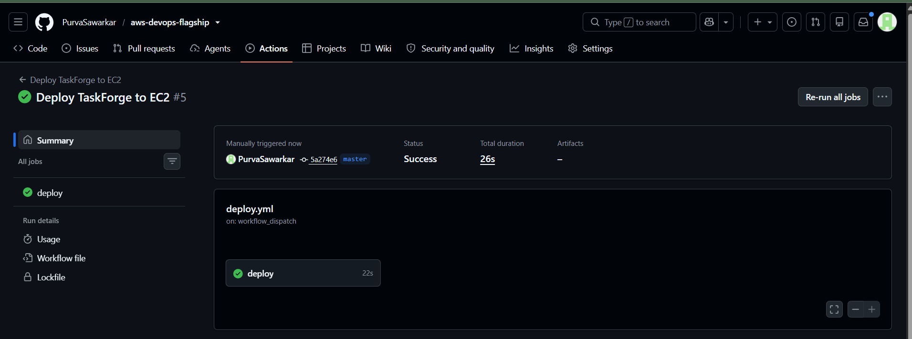
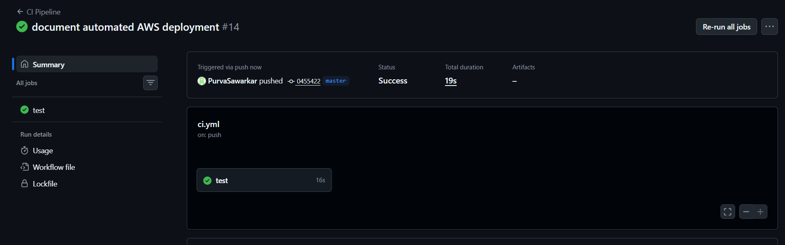
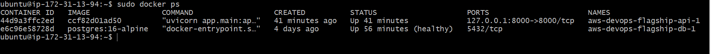

# TaskForge — AWS DevOps Flagship Project

**Build. Automate. Deploy. Verify.**

TaskForge is a cloud-hosted task management backend built with **FastAPI and PostgreSQL**, demonstrating modern DevOps practices through Docker, AWS, Terraform configuration, and GitHub Actions CI/CD.

The project demonstrates automated testing, secure AWS authentication using GitHub OIDC, and application deployment to an EC2 instance through AWS Systems Manager.

## Project at a Glance

| Component | Implementation |
|---|---|
| Backend | Python, FastAPI |
| Database | PostgreSQL 16 |
| Containers | Docker, Docker Compose |
| Cloud | AWS EC2 |
| CI/CD | GitHub Actions |
| AWS Authentication | GitHub OIDC, IAM |
| Deployment | AWS Systems Manager (SSM) |
| Infrastructure as Code | Terraform configuration |
| Terraform State Backend | Amazon S3 |

## Architecture

The following diagram shows how code moves from GitHub to the running application on AWS.



## CI/CD Pipeline

TaskForge uses GitHub Actions for automated application checks and deployment.

### Continuous Integration

- Python automated tests
- Code-quality checks
- Terraform formatting checks
- Terraform configuration validation

### Continuous Deployment

1. Developer pushes code to the `master` branch.
2. GitHub Actions starts the deployment workflow.
3. GitHub authenticates with AWS using OIDC.
4. AWS IAM validates the GitHub identity.
5. GitHub Actions sends deployment commands through AWS Systems Manager.
6. EC2 pulls the latest repository changes.
7. Docker Compose rebuilds and starts the application.
8. The workflow verifies application health.

## Project Execution Proof

### Automated Deployment



### Continuous Integration



### Application Running on Docker



The deployment was also verified using the FastAPI health endpoint:

```bash
curl -i http://localhost:8000/health
```

Expected response:

```json
{
  "status": "healthy"
}
```

## AWS Security

- GitHub OIDC authentication instead of long-lived AWS access keys.
- IAM role with restricted deployment permissions.
- AWS Systems Manager for remote deployment commands.
- Application port bound to localhost rather than publicly exposed.

## Terraform and Infrastructure Configuration

Terraform configuration is available in:

```text
infra/terraform/
```

The configuration includes:

- Amazon S3 remote state backend.
- S3 bucket versioning and encryption.
- S3 native state locking configuration using lockfiles.
- Terraform formatting and validation checks in CI.

**Current status:** Terraform configuration and CI validation are in place. Terraform has not yet been applied to provision the running EC2 infrastructure. The current EC2 instance was created separately.

Useful commands:

```bash
terraform -chdir=infra/terraform init
terraform -chdir=infra/terraform fmt -check -recursive
terraform -chdir=infra/terraform validate
terraform -chdir=infra/terraform plan
```

Review any infrastructure plan carefully before applying changes.

## Run Locally

### Prerequisites

- Python
- Docker
- Docker Compose

Clone the repository:

```bash
git clone https://github.com/PurvaSawarkar/aws-devops-flagship.git
cd aws-devops-flagship
```

Create a virtual environment:

```bash
python -m venv .venv
```

Activate it using Windows PowerShell:

```powershell
.venv\Scripts\Activate.ps1
```

Install development dependencies:

```bash
pip install -r requirements-dev.txt
```

Start the application:

```bash
docker compose up --build
```

Check the health endpoint:

```text
http://localhost:8000/health
```

## Project Status

### Implemented

- [x] FastAPI backend
- [x] PostgreSQL integration
- [x] Docker and Docker Compose
- [x] AWS EC2 application hosting
- [x] Terraform configuration and S3 backend setup
- [x] GitHub Actions CI pipeline
- [x] Terraform CI validation
- [x] GitHub OIDC authentication with AWS IAM
- [x] Automated deployment using AWS Systems Manager
- [x] Post-deployment health verification

### Future Improvements

- [ ] Monitoring and observability
- [ ] Centralized application logging
- [ ] Frontend development
- [ ] Expanded automated test coverage
- [ ] Further infrastructure automation

## Repository

**GitHub:** [aws-devops-flagship](https://github.com/PurvaSawarkar/aws-devops-flagship)

---

*TaskForge is a hands-on DevOps project focused on automating application delivery and deploying a containerized backend securely on AWS.*
